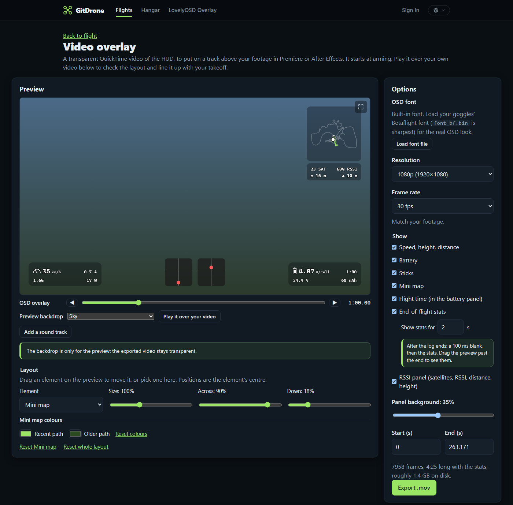

<div align="center">


# GitDrone

**Your flights, your tunes, and an OSD overlay for every video.**

GitDrone reads Betaflight blackbox logs and turns them into maps, charts and stick replays, keeps your tune
history, and makes a transparent OSD overlay for your FPV footage in your goggles' own font.

[](https://github.com/RobWiersma/GitDrone/actions/workflows/deploy.yml)
[](LICENSE)


**[Open the live site](https://gitdrone-bxa9ejf9gbhva9ek.westus3-01.azurewebsites.net/)** ·
[Try LovelyOSD](https://gitdrone-bxa9ejf9gbhva9ek.westus3-01.azurewebsites.net/osd) ·
[Features](#features) ·
[Getting started](#getting-started) ·
[How it works](#comparing-tunes)


<sub>Real footage with a LovelyOSD overlay rendered by GitDrone.</sub>

</div>

---

## Features

### 🎬 LovelyOSD overlays

Drop in a blackbox log and export a transparent `.mov` for Premiere Pro or After Effects: speed, battery,
sticks, a mini map, RSSI and a Betaflight-style stats screen at the end. Drag, resize and recolour every element,
draw it all in your goggles' `font_bf.bin`, and preview it full screen, playing over your own footage with sound,
synced to your takeoff automatically from the motor sound, the arming beep or a clap.
Free, no account, and nothing is uploaded: the video is rendered in your browser.

<p align="center">
  
</p>

<table>
  <tr>
    <td></td>
    <td></td>
    <td></td>
  </tr>
</table>

### 🗺️ Flight analysis

Every flight gets a GPS map (Leaflet + OpenStreetMap) with the path coloured by speed, a stick replay, charts for
height (GPS and barometer), speed, RSSI, voltage and current, and the numbers that matter: top speed, lowest cell,
mAh used, peak power, furthest distance from home.

<p align="center">
  
</p>

### 🎛️ Tune history

Paste a `diff all` after each change and see what you changed, grouped by profile and category (PIDs, filters,
rates, motors, ...). Compare any two tunes, even across aircraft, and see which tune each flight was flown on.

<p align="center">
  
</p>

### 🛩️ Your hangar

Each quad with its photo, specs, tune timeline (with firmware updates marked) and flights in one place.

<p align="center">
  
</p>

### 🏠 And a front page to show it off

<p align="center">
  
</p>

## Tech stack

| Layer | What |
|---|---|
| Frontend | [Angular 22](https://angular.dev/) (standalone components, signals), TypeScript, [Leaflet](https://leafletjs.com/) + OpenStreetMap, Canvas 2D for the overlay renderer |
| Backend | ASP.NET Core minimal APIs on .NET 10, Entity Framework Core with SQLite |
| Log decoding | `Services/BlackboxDecoder.cs`, a C# port of Betaflight's Blackbox Explorer decoder |
| Video | PNG frames in a QuickTime `.mov` written in the browser (`flights/mov-writer.ts`), alpha kept |
| Hosting | One free Linux Azure App Service (F1), deployed by GitHub Actions on every push to `master` |
| Auth | App Service Authentication (Microsoft), owner-only writes |

## Getting started

You need the [.NET 10 SDK](https://dotnet.microsoft.com/download) and [Node.js](https://nodejs.org/) 24.

```bash
# 1. API (https://localhost:5001)
cd DroneLogger.Api
dotnet run --launch-profile https

# 2. Frontend (http://localhost:4200), in a second terminal
cd drone-logger
npm install
npx ng serve
```

Open http://localhost:4200. The Angular dev server proxies `/api` and `/uploads` to https://localhost:5001
(`drone-logger/proxy.conf.json`). The database is SQLite and is created on first run. A sample `diff all` to import
lives in `DroneLogger.Api/samples/diff-all-sample.txt`.

## Project structure

```text
GitDrone/
├── DroneLogger.Api/              ASP.NET Core API (.NET 10)
│   ├── Endpoints/                Aircraft, tunes, flights, visits
│   ├── Services/                 BlackboxDecoder, FlightTrack, TuneParser, TuneDiff, stores
│   ├── Domain/ · Data/           Entities and EF Core DbContext
│   ├── Migrations/               EF Core migrations (SQLite)
│   └── samples/                  Sample Betaflight diff all
├── drone-logger/                 Angular 22 frontend
│   ├── public/                   Icons and home page footage stills
│   └── src/app/
│       ├── aircraft/             Hangar: list, detail, form
│       ├── flights/              Flight pages, map, charts, playback, overlay renderer and export
│       ├── osd/                  LovelyOSD (no-account overlay tool)
│       ├── tunes/                Import, timeline, compare
│       └── home/ · stats/        Front page and visitor stats
├── docs/screenshots/             Images for this README
└── .github/workflows/deploy.yml  Build Angular into wwwroot and deploy to Azure
```

## Reference

<details>
<summary><b>Routes</b></summary>

| Route                        | Component                  |
|------------------------------|----------------------------|
| /                            | HomeComponent              |
| /flights                     | FlightFeedComponent        |
| /hangar                      | AircraftListComponent      |
| /hangar/new                  | AircraftFormComponent      |
| /hangar/:id                  | AircraftDetailComponent    |
| /hangar/:id/edit             | AircraftFormComponent      |
| /hangar/:id/tunes/import     | TuneImportComponent        |
| /hangar/:id/tunes/bulk       | TuneBulkImportComponent    |
| /tunes/compare?from=&to=     | TuneCompareComponent       |
| /hangar/:id/flights/upload   | FlightUploadComponent      |
| /flights/:id                 | FlightDetailComponent      |
| /flights/:id/overlay         | FlightOverlayComponent     |
| /osd                         | LovelyOsdComponent         |
| /stats                       | StatsComponent (signed in) |

</details>

<details>
<summary><b>API contract</b></summary>

```text
GET    /api/aircraft
GET    /api/aircraft/{id}
POST   /api/aircraft            multipart/form-data (fields + `image` file)
PUT    /api/aircraft/{id}       multipart/form-data (fields + `image`, `removeImage`)
DELETE /api/aircraft/{id}
GET    /api/aircraft/{id}/tunes
POST   /api/aircraft/{id}/tunes  body: { label, notes?, rawText }
                                   returns: { snapshot, duplicateOf }
POST   /api/aircraft/{id}/tunes/bulk  body: { items: [{ label, notes?, rawText, createdAt? }] } (max 500)
                                   returns: [{ index, status: created|duplicate|error, snapshot, duplicateOf, error }]
                                   Each item lands at its createdAt; one identical to the snapshot before it is skipped.
GET    /api/tunes/{id}/raw        returns: { id, rawText }
GET    /api/tunes/compare?from={snapshotId}&to={snapshotId}
                                   returns: { from, to, changed, added, removed, unchanged,
                                              groups: [{ scope, scopeLabel, category, changes: [{ key, from, to, kind }] }] }
                                   from/to on a change is null when that side is at the firmware default.
GET    /api/aircraft/{id}/flights
POST   /api/aircraft/{id}/flights  multipart/form-data: file (.bbl/.bfl, max 64 MB), tuneSnapshotId? (empty = match by date), notes?
                                   returns: { flights, duplicate }  (one flight per armed session in the file)
GET    /api/flights/{id}
PUT    /api/flights/{id}          body: { tuneSnapshotId, notes }
DELETE /api/flights/{id}
GET    /api/flights/{id}/telemetry  returns: { points: [[t, rssi %|null, baro height above takeoff (m)|null], ...] } at 10 Hz,
                                   or 404 when the log has neither rssi nor baroAlt
POST   /api/osd/analyze          multipart/form-data: file (.bbl/.bfl, max 64 MB)
                                   returns: { fileName, sessions: [{ flight, track, sticks, battery, telemetry }] }
                                   Decodes in memory and stores nothing. flight.id is 0; track/sticks/battery match the
                                   per-flight endpoints, or null.
```

</details>

## Comparing tunes

Each timeline entry has "Compare with previous". The compare page lets you pick any two
snapshots, including from different aircraft, and shows changes grouped by profile and
category (PIDs, filters, rates, motors, ...). "Newly set" and "back to default" reflect that
`diff all` only lists non-default values.

## Flights (blackbox logs)

Upload a Betaflight `.bbl`/`.bfl` file on the aircraft page. The API decodes it itself
(`Services/BlackboxDecoder.cs`, ported from betaflight/blackbox-log-viewer), creates one flight per
armed session, and links each to the newest tune saved before that flight (or the tune you pick).
Craft name and device UID from the log header are not stored. The original file is kept in
`App_Data/logs` so it can be re-parsed later, for example to add GPS tracks once logs include them
(enable the GPS field in the Configurator's Blackbox tab).

Flights with GPS get distance, top speed, max height above takeoff and furthest distance from home,
plus a map (Leaflet + OpenStreetMap tiles) with the path coloured by speed. `POST /api/flights/{id}/reprocess`
re-reads the stored log file, e.g. after a decoder change. `GET /api/flights/{id}/track` returns the path.

Logs with `rssi` get a lowest-RSSI stat, an RSSI chart and an RSSI element on the overlay. This is the signal
strength Betaflight logs (shown 0–100% like its OSD), not link quality, which Betaflight doesn't write to the blackbox.
Logs with `baroAlt` get the barometer height drawn dashed on the height chart next to GPS, and the overlay can take
its altitude from either.

## Video overlay

Each flight page has **Export video overlay** (`/flights/:id/overlay`), and LovelyOSD has the same tool: a
transparent HUD video to put on a track above your footage in Premiere Pro or After Effects. It shows:

- a **speed panel**: speed, G-force, current and power;
- a **battery panel**: per-cell and pack voltage, flight time and mAh used;
- a **mini map** with an **RSSI panel** under it: satellites, RSSI, distance from home and height (GPS or barometer);
- both **sticks** in Blackbox Explorer style (modes 1–4) with motion trails;
- a Betaflight-style **stats screen** at the end (a 0.1 s blank, then TOTAL ARM, MAX SPEED, MIN BATTERY, ...).

It can draw everything with your goggles' Betaflight OSD font (`font_bf.bin` / `font_bf_hd.bin`, DJI WTFOS format),
including Betaflight's own icons.

**Layout.** Drag any element on the preview to move it, and set each one's size (50–200%) under Layout; the same
controls also move elements from the keyboard. The timer, RSSI, speed and battery panels also let you size each reading
inside them (speed, G-force, satellites, pack voltage, mAh, ...), and the panel grows or shrinks to fit. Positions are stored as fractions of the frame, so a layout looks the
same at every resolution, and it's remembered in your browser. Elements always stay fully inside the frame.

**Preview over your own video.** Pick **Play it over your video** under the preview to play your flight footage
behind the overlay, synced live (the file plays from your computer; nothing is uploaded). To line them up, move the
**Flight footage** slider (◀ ▶ step single frames) to the moment you leave the ground and press **Takeoff is here**:
GitDrone finds takeoff in the log as the first throttle punch over 20%, or the first GPS movement without stick data.
**Arming is here** does the same on the arming moment, and **Log starts at** holds the result, so you can type it too.
The overlay is hidden before the log starts, like in your editor. H.264 MP4s play everywhere; H.265 only in some
browsers. If the footage has its own sound (an onboard camera hears its motors), **Sync from motor sound** finds Log
starts at for you: it slides the footage's loudness (high-passed at 800 Hz, on a log scale) along the throttle trace and
keeps the best correlation, and only applies it when the match clearly beats every other position.

**A sound track from another recording.** **Add a sound track** plays a second file's sound (a phone on the ground,
say) instead of the footage's own. It's its own track, placed on the log just like the footage, with its own
**Log starts at**, so moving the footage never moves the sound. Its loudness is drawn with what was heard in it marked
(hover to read times), and the **Sound track** slider (or a click on the graph) moves only the sound, to find a moment in
it. Ways to place it (`flights/clap.ts`):

- **Arming and launch sound**, done for you when the file is added. A phone near the quad hears the motors arm, a jump
  from quiet to a steady idle, then the launch exactly as long after as the log says; that moment is where the log
  starts. No sound is needed in the footage.
- **Takeoff is here / Arming is here** under the sound track, after moving it to that moment by ear or by the graph.
- **A clap**, with footage loaded. The audio is high-passed at 2.5 kHz and the first sudden burst far above the half
  second before it is the clap. Pick which clap in the sound, find it in the footage (found from the footage's own sound,
  or step to the frame and press **Clap is here**), and **Sync on the clap** places the sound so the two land together.

It works without footage too: with the Checkerboard or Sky backdrop, **Play** runs the overlay along with the sound.
Preview only: the exported overlay has no sound; in Premiere, Synchronize → Audio lines the two up. Checkerboard and Sky backdrops are there too; none of them end up in the export.

**How it renders.** Everything happens in the browser; nothing is uploaded. Each frame is drawn on a canvas
straight from the decoded log data (no playback, no screen capture), encoded as a PNG, and written into a
QuickTime `.mov` with the PNG codec, which keeps the alpha channel so the overlay is transparent without
keying. In Chrome and Edge the file streams straight to disk, so long or 4K exports don't fill up memory.

**Speed.** Rendering isn't tied to playback, so it runs faster than real time. Measured at 1080p: about
21 ms per frame, so a 7-minute flight at 30 fps (≈12,750 frames) renders in roughly 4½ minutes. Higher
resolutions and frame rates take proportionally longer (4K has 4× the pixels per frame), and the page shows a
live ETA while it works.

**Size.** The video is lossless, so it's large: about 170 KB per 1080p frame, roughly 2.2 GB for that
7-minute flight. Your editor's final export brings it back to normal size.

In Premiere: import the `.mov` and put it on a track above the footage. If you synced it to your video in the
preview, the page tells you where the clip starts in your footage; otherwise slide it until it matches your takeoff.
If it shows black instead of transparent, set Interpret Footage → Alpha Channel to Straight.

## LovelyOSD Overlay

The **LovelyOSD Overlay** tab (`/osd`) is the quick route: pick a blackbox log, see the same stats, map, playback
and charts as a flight page, and export the overlay video, without adding anything to the hangar. The API reads the
file in memory and forgets it (nothing goes into the database or `App_Data/logs`), and the results only live on the
page, so leaving it clears them. A file with several armed sessions gets a session picker. It's open to visitors who
aren't signed in, since nothing is stored; to protect the small App Service plan, the API decodes at most two logs at
once (two more wait, the rest get a "busy, try again" 503).

## Deploying to Azure (free tier)

One Linux App Service (F1) hosts both: CI builds Angular into the API's `wwwroot`
(`.github/workflows/deploy.yml`, runs on every push to `master`).

App settings on the App Service:

| Setting                      | Value                                  |
|------------------------------|----------------------------------------|
| `ConnectionStrings__Default` | `Data Source=/home/data/droneLogger.db` |
| `Storage__UploadsPath`       | `/home/data/uploads`                   |
| `Storage__LogsPath`          | `/home/data/logs`                      |
| `Auth__OwnerIds`             | Your account id (comma-separate several) |

`/home` survives restarts and deploys, so SQLite is fine on a single instance. Turn on App Service
Authentication (Microsoft provider) with **Allow unauthenticated access**: visitors can browse and use LovelyOSD.
Only **owners** can add or change anything or see visitor stats: accounts whose id is in `Auth__OwnerIds`. Signing in
with any other account changes nothing, and with the setting empty nobody can make changes (the API enforces all of
this). Your id is the **Object ID** under Microsoft Entra ID → Users → your user.
GitHub needs variable `AZURE_WEBAPP_NAME` and secret `AZURE_WEBAPP_PUBLISH_PROFILE`.

## Visitor stats

`/stats` (signed in only) shows unique visitors per day, the pages they open and the sites that sent them, without
cookies and without storing IP addresses:

- On each page change the site calls `POST /api/visit` with the page and, on the landing page only, the referring
  site's **hostname** (never the full link).
- The API stores a 16-character hash of IP + browser + **today's secret**, the day, the page folded onto its route
  (`/flights/8` becomes `/flights/:id`) and the referrer name. The secret is random, kept in `VisitSalts`, and deleted
  once the day is over, so old hashes can't be recomputed or linked to anyone.
- The same person on two days counts as two; nobody can be followed over time. Signed-in visits and obvious bots
  aren't counted.
- `GET /api/stats/visits?days=30` returns the numbers (signed in only).

## License

GitDrone is free software under the [GNU General Public License v3.0](LICENSE). You can use, study, share and change
it; if you distribute a modified version, it has to stay under the GPL too.

## Credits

GitDrone stands on the open-source FPV world:

- **[Betaflight](https://github.com/betaflight/betaflight)** (GPL-3.0): the flight controller firmware whose logs,
  `diff all` format and OSD symbol codes (`osd_symbols.h`) this reads.
- **[Blackbox Explorer](https://github.com/betaflight/blackbox-log-viewer)** (GPL-3.0): `Services/BlackboxDecoder.cs`
  is a port of its log decoder, which is why GitDrone is GPL-3.0 as well.
- **[WTFOS msp-osd](https://github.com/fpv-wtf/msp-osd)**: the DJI goggles font format LovelyOSD reads. Fonts are
  loaded from your own computer and never uploaded or bundled here.
- **[Leaflet](https://leafletjs.com/)** (BSD-2-Clause) and **[OpenStreetMap](https://www.openstreetmap.org/copyright)**
  contributors (ODbL) for the flight maps.
