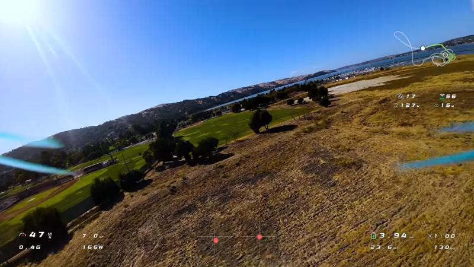
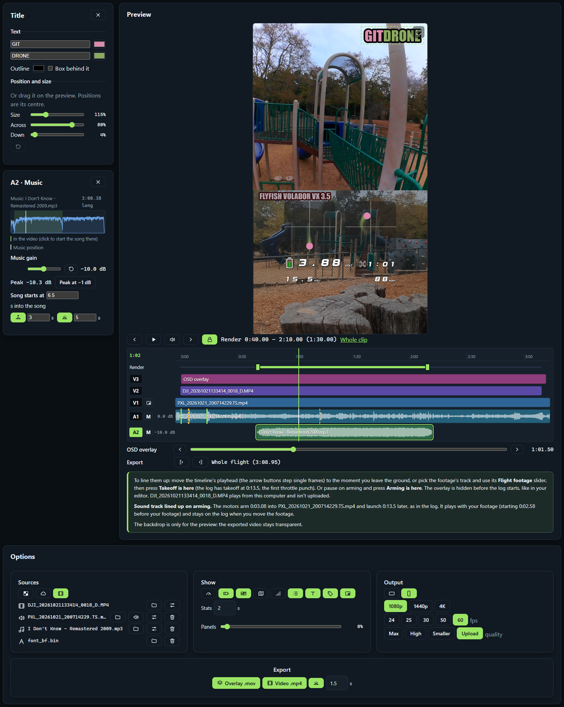
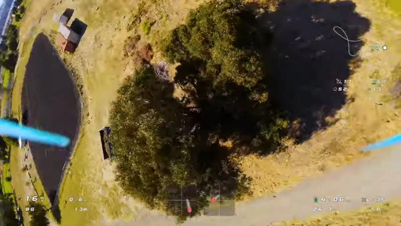
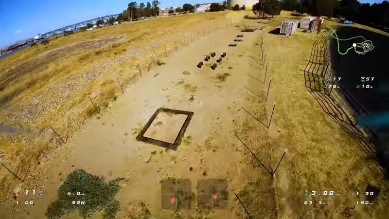
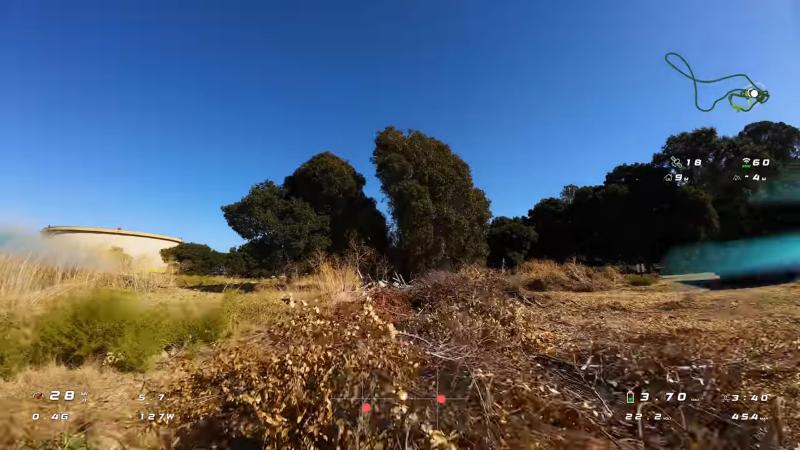
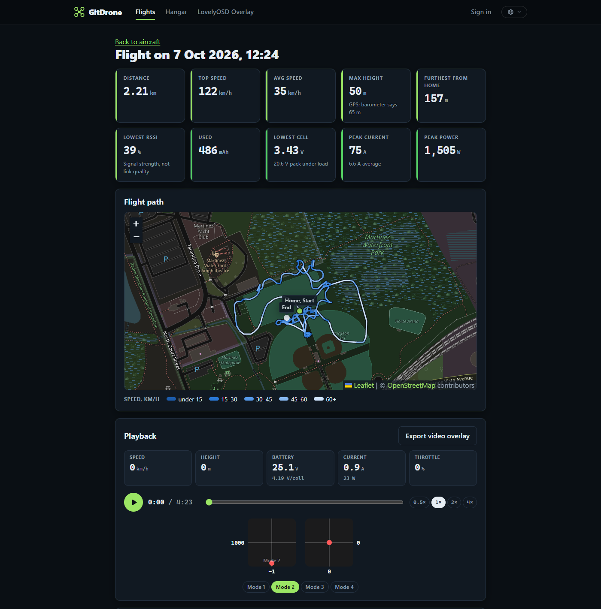
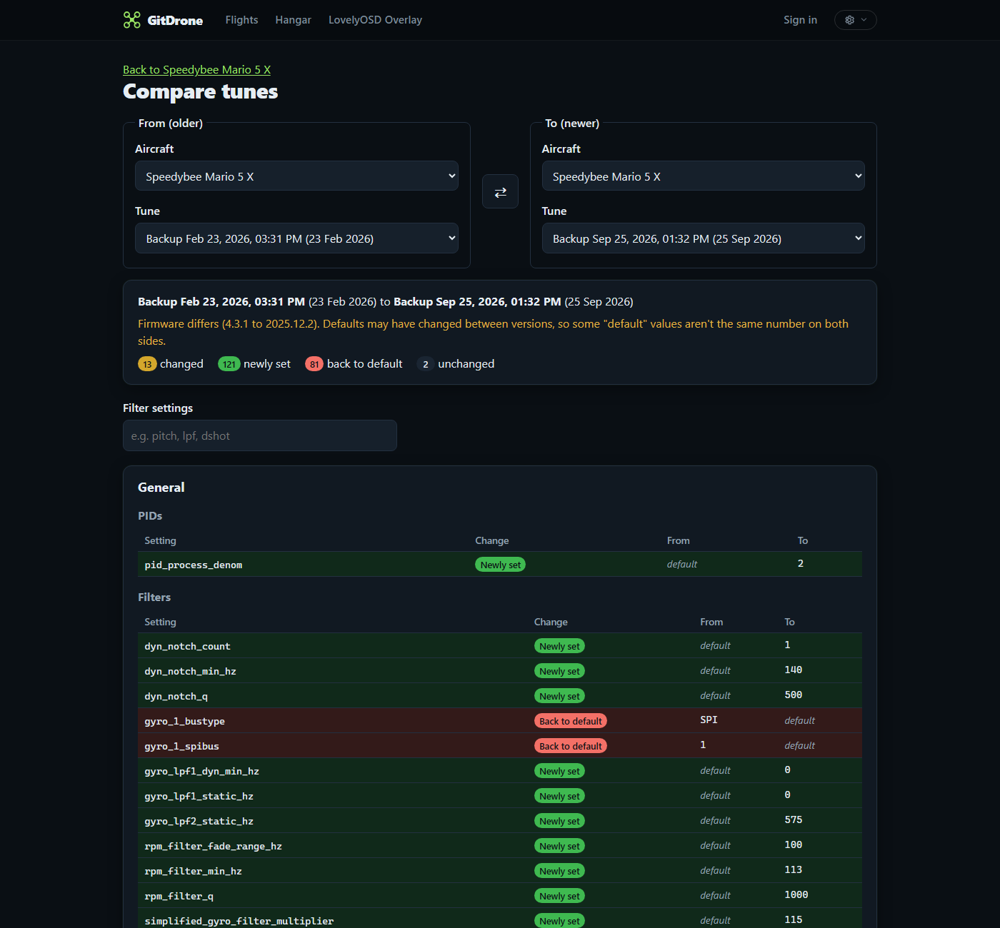
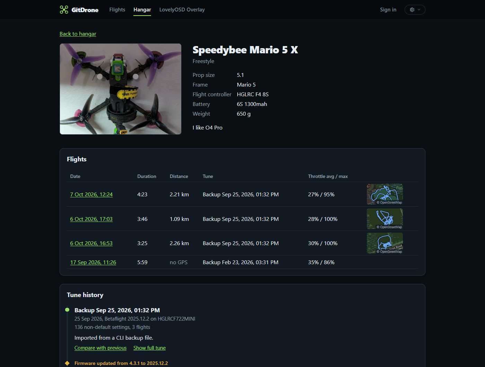
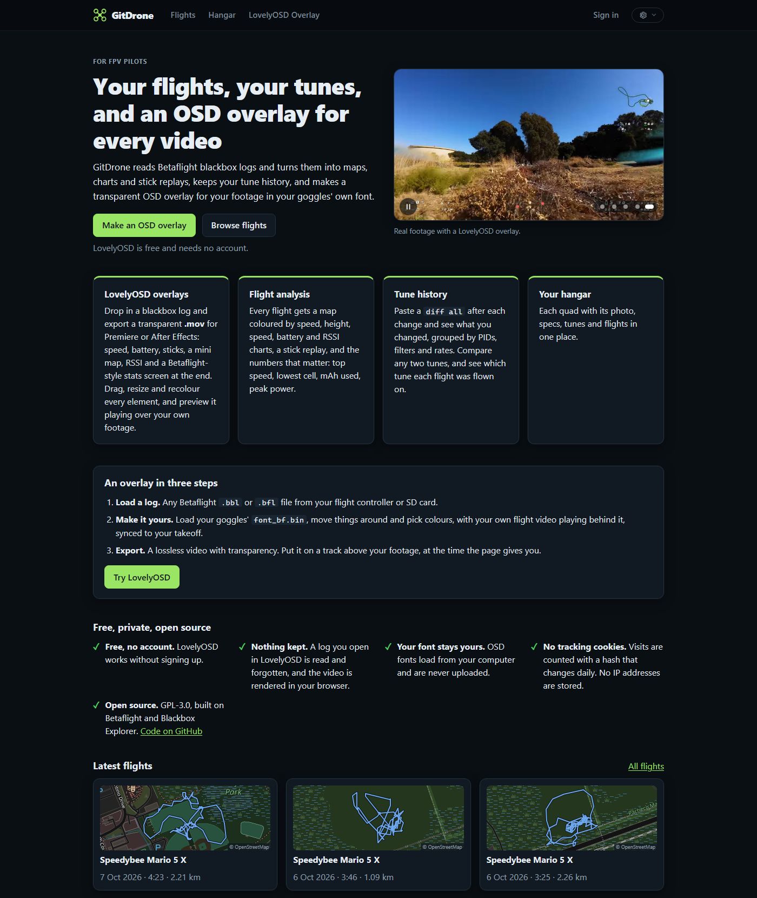

<div align="center">


# GitDrone

**LovelyOSD Editor: your FPV footage with its OSD, ready to upload.**

Drop in your Betaflight blackbox log (straight off the quad over USB, if you like) and your footage. LovelyOSD Editor
lines them up on your takeoff, draws your OSD in your goggles' own font, grades the picture, mixes your sound and music,
and renders a finished video or YouTube Short on your GPU, near lossless, right in your browser. Or it exports a
transparent OSD overlay for Premiere. GitDrone, around it, keeps your flights as maps, charts and stick replays, and
your tune history.

[](https://github.com/RobWiersma/GitDrone/actions/workflows/deploy.yml)
[](LICENSE)


**[Open the live site](https://lovelyosd.com/)** ·
[Open LovelyOSD Editor](https://lovelyosd.com/osd) ·
[Features](#features) ·
[Getting started](#getting-started) ·
[Shorts](#vertical-video-shorts-reels-tiktok) ·
[How it works](#comparing-tunes)



<sub>Real footage with its OSD, made in LovelyOSD Editor.</sub>

</div>

---

## Features

### 🎬 LovelyOSD Editor

Free, no install, no account, at `/osd`. Drop in a blackbox log and your footage for a finished video (below), or
export a transparent `.mov` for Premiere Pro or After Effects: speed, battery,
sticks, a mini map, RSSI and a Betaflight-style stats screen at the end. Drag, resize and recolour every element,
draw it all in your goggles' WTFOS font, and preview it full screen, playing over your own footage with sound,
synced to your takeoff automatically from the motor sound, the arming beep or a clap. A Premiere-style timeline shows
the footage, OSD, sound and music as tracks, locked together once they're synced, with waveforms that turn red where
they clip. Free, no account, and nothing is uploaded: the video is rendered in your browser. No files handy?
**Try a sample flight** (or [`/osd?sample`](https://lovelyosd.com/osd?sample)) loads a real one.

### 📱 Finished videos and Shorts

Skip the editor: GitDrone renders the finished `.mp4` itself, with your footage, a stick cam, the sound and the OSD baked
in, fast and near lossless on your GPU's video encoder, at the resolution your footage was shot in (4K stays 4K). Make it **landscape 16:9** for YouTube or **vertical 9:16** for Shorts,
Reels and TikTok, a split screen with your FPV footage on top, the stick cam below, big sticks and the battery over it,
and the bottom kept clear of the Shorts buttons. Add a **title** in two colours and your **craft name** in Impact with an
outline, colour your footage like Lumetri's Basic Correction (temperature, tint, saturation, exposure, contrast,
highlights, shadows, whites, blacks), zoom both videos, add a **music** track, set each sound's gain and fades, pick the part to render, and
fade out at the end, with Betaflight's post-flight stats as the last frame holds. The frame rate follows your footage
(100 or 120 fps footage comes out at 60).

<p align="center">
  
</p>

### 🔌 Logs straight off the quad

Plug the flight controller in over USB, press **Connect FC over USB** and GitDrone reboots it into mass storage mode,
the same as the Configurator's button, then opens its drive and loads the newest log. No Configurator, no copying files
(Chrome or Edge).

<p align="center">
  
</p>

<table>
  <tr>
    <td></td>
    <td></td>
    <td></td>
  </tr>
</table>

### 🗺️ Flight analysis

Every flight gets a GPS map (Leaflet + OpenStreetMap) with the path coloured by speed, a stick replay, charts for
height (GPS and barometer), speed, RSSI, voltage and current, and the numbers that matter: top speed, lowest cell,
mAh used, peak power, furthest distance from home.

<p align="center">
  
</p>

### 🎛️ Tune history

Paste a `diff all` after each change and see what you changed, grouped by profile and category (PIDs, filters,
rates, motors, ...). Compare any two tunes, even across aircraft, and see which tune each flight was flown on.

<p align="center">
  
</p>

### 🛩️ Your hangar

Each quad with its photo, specs, tune timeline (with firmware updates marked) and flights in one place.

<p align="center">
  
</p>

### 🏠 And a front page to show it off

<p align="center">
  
</p>

## Tech stack

| Layer | What |
|---|---|
| Frontend | [Angular 22](https://angular.dev/) (standalone components, signals), TypeScript, [Leaflet](https://leafletjs.com/) + OpenStreetMap, Canvas 2D for the overlay renderer |
| Backend | ASP.NET Core minimal APIs on .NET 10, Entity Framework Core with SQLite |
| Log decoding | `Services/BlackboxDecoder.cs`, a C# port of Betaflight's Blackbox Explorer decoder |
| Video | Overlay: PNG frames in a QuickTime `.mov` written in the browser (`flights/mov-writer.ts`), alpha kept. Finished video: H.264/AAC `.mp4` decoded, composited and encoded in the browser with WebCodecs via [Mediabunny](https://mediabunny.dev/) (`flights/video-render.ts`), its sound mixed with Web Audio. Editor timeline: `flights/track-timeline.component.ts` |
| USB | Web Serial (MSP) to reboot the flight controller into mass storage, File System Access to read its drive (`flights/fc-usb.ts`) |
| Hosting | One free Linux Azure App Service (F1), deployed by GitHub Actions on every push to `master` |
| Auth | App Service Authentication (Microsoft), owner-only writes |

## Getting started

You need the [.NET 10 SDK](https://dotnet.microsoft.com/download) and [Node.js](https://nodejs.org/) 24.

```bash
# 1. API (https://localhost:5001)
cd DroneLogger.Api
dotnet run --launch-profile https

# 2. Frontend (http://localhost:4200), in a second terminal
cd drone-logger
npm install
npx ng serve
```

Open http://localhost:4200. The Angular dev server proxies `/api` and `/uploads` to https://localhost:5001
(`drone-logger/proxy.conf.json`). The database is SQLite and is created on first run. A sample `diff all` to import
lives in `DroneLogger.Api/samples/diff-all-sample.txt`.

## Project structure

```text
GitDrone/
├── DroneLogger.Api/              ASP.NET Core API (.NET 10)
│   ├── Endpoints/                Aircraft, tunes, flights, visits
│   ├── Services/                 BlackboxDecoder, FlightTrack, TuneParser, TuneDiff, stores
│   ├── Domain/ · Data/           Entities and EF Core DbContext
│   ├── Migrations/               EF Core migrations (SQLite)
│   └── samples/                  Sample Betaflight diff all
├── drone-logger/                 Angular 22 frontend
│   ├── public/                   Icons, the home page clip and stills, and the sample flight (samples/)
│   └── src/app/
│       ├── aircraft/             Hangar: list, detail, form
│       ├── flights/              Flight pages, map, charts, playback, overlay editor and export, finished-video
│       │                         render, logs over USB
│       ├── icon.component.ts     The small outline icons used across the editor
│       ├── osd/                  LovelyOSD Editor (no-account video and overlay tool)
│       ├── guides/               How-to pages written for search, like adding your OSD to DJI O4 footage
│       ├── tunes/                Import, timeline, compare
│       ├── about/                The public By the numbers page
│       └── home/ · stats/        Front page and visitor stats
├── docs/screenshots/             Images for this README
└── .github/workflows/deploy.yml  Build Angular into wwwroot and deploy to Azure
```

## Reference

<details>
<summary><b>Routes</b></summary>

| Route                        | Component                  |
|------------------------------|----------------------------|
| /                            | HomeComponent              |
| /flights                     | FlightFeedComponent        |
| /hangar                      | AircraftListComponent      |
| /hangar/new                  | AircraftFormComponent      |
| /hangar/:id                  | AircraftDetailComponent    |
| /hangar/:id/edit             | AircraftFormComponent      |
| /hangar/:id/tunes/import     | TuneImportComponent        |
| /hangar/:id/tunes/bulk       | TuneBulkImportComponent    |
| /tunes/compare?from=&to=     | TuneCompareComponent       |
| /hangar/:id/flights/upload   | FlightUploadComponent      |
| /flights/:id                 | FlightDetailComponent      |
| /flights/:id/overlay         | FlightOverlayComponent     |
| /osd                         | LovelyOsdComponent         |
| /stats                       | StatsComponent (signed in) |

</details>

<details>
<summary><b>API contract</b></summary>

```text
GET    /api/aircraft
GET    /api/aircraft/{id}
POST   /api/aircraft            multipart/form-data (fields + `image` file)
PUT    /api/aircraft/{id}       multipart/form-data (fields + `image`, `removeImage`)
DELETE /api/aircraft/{id}
GET    /api/aircraft/{id}/tunes
POST   /api/aircraft/{id}/tunes  body: { label, notes?, rawText }
                                   returns: { snapshot, duplicateOf }
POST   /api/aircraft/{id}/tunes/bulk  body: { items: [{ label, notes?, rawText, createdAt? }] } (max 500)
                                   returns: [{ index, status: created|duplicate|error, snapshot, duplicateOf, error }]
                                   Each item lands at its createdAt; one identical to the snapshot before it is skipped.
GET    /api/tunes/{id}/raw        returns: { id, rawText }
GET    /api/tunes/compare?from={snapshotId}&to={snapshotId}
                                   returns: { from, to, changed, added, removed, unchanged,
                                              groups: [{ scope, scopeLabel, category, changes: [{ key, from, to, kind }] }] }
                                   from/to on a change is null when that side is at the firmware default.
GET    /api/aircraft/{id}/flights
POST   /api/aircraft/{id}/flights  multipart/form-data: file (.bbl/.bfl, max 64 MB), tuneSnapshotId? (empty = match by date), notes?
                                   returns: { flights, duplicate }  (one flight per armed session in the file)
GET    /api/flights/{id}
PUT    /api/flights/{id}          body: { tuneSnapshotId, notes }
DELETE /api/flights/{id}
GET    /api/flights/{id}/telemetry  returns: { points: [[t, rssi %|null, baro height above takeoff (m)|null], ...] } at 10 Hz,
                                   or 404 when the log has neither rssi nor baroAlt
POST   /api/osd/analyze          multipart/form-data: file (.bbl/.bfl, max 64 MB)
                                   returns: { fileName, sessions: [{ flight, track, sticks, battery, telemetry }] }
                                   Decodes in memory and stores nothing. flight.id is 0; track/sticks/battery match the
                                   per-flight endpoints, or null.
```

</details>

## Comparing tunes

Each timeline entry has "Compare with previous". The compare page lets you pick any two
snapshots, including from different aircraft, and shows changes grouped by profile and
category (PIDs, filters, rates, motors, ...). "Newly set" and "back to default" reflect that
`diff all` only lists non-default values.

## Flights (blackbox logs)

Upload a Betaflight `.bbl`/`.bfl` file on the aircraft page, or get it straight off the quad: plug the flight controller
in over USB (no battery needed), press **Connect FC over USB** and then **Open FC drive**. In Chrome and Edge, GitDrone
sends the flight controller the same MSP reboot-to-mass-storage command as the Configurator's "Activate Mass Storage
Device Mode" button (`flights/fc-usb.ts`, Web Serial), then lists the logs on the drive it becomes and picks the newest.
LovelyOSD Editor has the same buttons. Eject the drive and unplug the quad afterwards to put it back to normal. The API decodes it itself
(`Services/BlackboxDecoder.cs`, ported from betaflight/blackbox-log-viewer), creates one flight per
armed session, and links each to the newest tune saved before that flight (or the tune you pick).
Craft name and device UID from the log header are not stored. The original file is kept in
`App_Data/logs` so it can be re-parsed later, for example to add GPS tracks once logs include them
(enable the GPS field in the Configurator's Blackbox tab).

Flights with GPS get distance, top speed, max height above takeoff and furthest distance from home,
plus a map (Leaflet + OpenStreetMap tiles) with the path coloured by speed. `POST /api/flights/{id}/reprocess`
re-reads the stored log file, e.g. after a decoder change. `GET /api/flights/{id}/track` returns the path.

Logs with `rssi` get a lowest-RSSI stat, an RSSI chart and an RSSI element on the overlay. This is the signal
strength Betaflight logs (shown 0–100% like its OSD), not link quality, which Betaflight doesn't write to the blackbox
on its own. With Crossfire or ELRS, set `debug_mode = CRSF_LINK_STATISTICS_UPLINK` and log the debug fields: Betaflight
then logs the receiver's uplink RSSI in dBm (each antenna) in `debug[0]` and `debug[1]`, and **link quality** in
`debug[2]`. Those logs also get a lowest-LQ stat, LQ and dBm charts, LQ and dBm in the overlay's RSSI panel (LQ amber
below Betaflight's 80% alarm) and MIN LINK and MIN RSSI DBM on the stats screen.
Logs with `baroAlt` get the barometer height drawn dashed on the height chart next to GPS, and the overlay can take
its altitude from either.

## Video overlay

Each flight page has **Export video overlay** (`/flights/:id/overlay`), and LovelyOSD Editor has the same tool: a
transparent HUD video to put on a track above your footage in Premiere Pro or After Effects. It shows:

- a **speed panel**: speed, G-force, current and power;
- a **battery panel**: per-cell and pack voltage, flight time (always shown) and mAh used;
- an **LQ and cell panel** for logs with link quality: the per-cell voltage and LQ at the battery panel's headline
  size, centred just above the sticks (off until you turn it on under Show);
- a **mini map** with an **RSSI panel** under it: satellites, RSSI (and link quality and dBm when logged), distance
  from home and height (GPS or barometer);
- both **sticks** in Blackbox Explorer style (modes 1–4) with motion trails; or **Pixel**, the same in chunky pixels like
  the OSD font (a pixel-art box with stepped corners, each stick an empty white ring); or **Retro**: Betaflight's own OSD stick
  overlay, a 7 × 5 grid of characters drawn from your OSD font (chunky pixels without one), on a pixel-art backdrop
  with stepped corners. The sticks' **Backdrop** slider sets their boxes' opacity apart from the other panels;
- a Betaflight-style **stats screen** at the end (a 0.1 s blank, then TOTAL ARM, MAX SPEED, MIN BATTERY, ...);
- a **title** in two colours (your channel name, say) and your **craft name**, in Impact with an outer stroke like a
  Premiere title, or no box at all. They start on in vertical and off in 16:9; their toggles are under **Show**;
- a small **OSD by lovelyosd.com** credit at the end, under the stats screen (or over the last 3 seconds when the stats
  are off), so pilots who see your video can find the editor. It's on by default; untick **Credit lovelyosd.com** under **Show** to leave it off.

It can draw the HUD with your goggles' Betaflight OSD font, including Betaflight's own icons: WTFOS msp-osd's `.png` fonts
(`font_btfl.png` / `font_btfl_hd.png`, since msp-osd 0.12, and Walksnail's `_36` / `_24` files, the same format) or the older
`.bin` (`font_bf.bin` / `font_bf_hd.bin`). **Get a font**, next to the font under Sources, links to
[WTFOS's .bin fonts](https://github.com/fpv-wtf/msp-osd/tree/v0.11.1/fonts) (msp-osd 0.11.1, the last release with them). The title and craft name use a display font (Impact) by default; each has a **Font** setting to
draw it in the OSD font instead, tinted in its colours.

**The editor.** It's laid out like Premiere: a **Components** panel and a **Track** panel on the left of the preview, a
**timeline** under it, and **Options** along the bottom. Click an OSD element in the preview (or the title or craft
name) and Components shows everything about it, grouped: text and colours, position and size (50–300%), the size of
each reading inside a panel (speed, G-force, satellites, pack voltage, mAh, ...), stick mode, trails and colours. The
RSSI panel's readings (satellites, RSSI, dBm, link quality, distance and height; those the log has) each have a
checkbox to switch them off, and the panel shrinks to what's left; one always stays on. With nothing picked, it lists every element to choose from, so it all works from the keyboard too.

**The timeline** shows every file as a track where its sync puts it, like Premiere's: V2 the OSD over V1 the footage
(and the stick cam under them in vertical), then A1 the sound (the sound track, or the footage's own) and A2 the music,
trimmed to what plays. Sound tracks show their waveform at their gain, red where they clip, with an **M** to mute them
(in the preview and the finished video) and the gain in the header. Drag along the ruler to move the playhead; the
**Render** range sits over the clips. The sound track's clip also marks the arming and launch it heard, its claps and
where the sound is; hover one (or Tab to it) for what it is. Click a track (or a video in the preview) and
the **Track** panel shows its settings: sync, colour and framing for the footage, picture and framing for the stick
cam, gain and sync for the sound, and gain, start and fades for the music. Options holds
the rest in three boxes, **Sources** (the backdrop, footage, sound track, music and OSD font), **Show** (one icon toggle per HUD
element, the title and craft name, the stats length, the panel background and the credit) and **Output** (format, resolution and
frame rate), with a full-width **Export** row under them for the two render buttons.
Small buttons are icons; hover any of them for what it does. Positions are stored as fractions of the frame, so a layout
looks the same at every resolution, and it's remembered in your browser. Elements always stay fully inside the frame.
So are the rest of your settings: the footage's grade and zoom, the stick cam's picture, the sound's and music's gains
and fades, the stats length and each format's Show toggles, so every new video starts from your last setup. The sync and
ranges belong to each video, and live in its saved session.

**Preview over your own video.** Load your flight footage under **Sources** to play it behind the overlay, synced live
(the file plays from your computer; nothing is uploaded). Its colour is graded like Lumetri's Basic Correction
(Temperature, Tint, Saturation, Exposure, Contrast, Highlights, Shadows, Whites and Blacks, on the GPU with WebGL, so the
preview shows exactly what renders; `flights/grade.ts`), and its zoom is in its Track panel too; 4:3 footage shows whole in the 16:9 frame. To line them up, move the
playhead (the arrow buttons step single frames), or the **Flight footage** slider in the footage's Track panel, to the
moment you leave the ground and press **Takeoff is here** there:
GitDrone finds takeoff in the log as the first throttle punch over 20%, or the first GPS movement without stick data.
**Arming is here** does the same on the arming moment, and **Log starts at** holds the result, so you can type it too.
The overlay is hidden before the log starts, like in your editor. H.264 MP4s play everywhere; H.265 only in some
browsers. If the footage has its own sound (an onboard camera hears its motors), **Sync from motor sound** finds Log
starts at for you: it slides the footage's loudness (high-passed at 800 Hz, on a log scale) along the throttle trace and
keeps the best correlation, and only applies it when the match clearly beats every other position.

**A sound track from another recording.** A sound track under **Sources** plays a second file's sound (a phone on the
ground, or a stick cam) instead of the footage's own. In vertical, if it's a video, its picture fills the bottom half of
the split screen (toggle it under **Show**), with its own brightness, contrast, saturation, zoom and pan; in 16:9 it
plays just its sound, so the footage keeps the whole frame. It's its own track, placed on the log just like the footage, with its own
**Log starts at**, so moving the footage never moves the sound. Its clip on the timeline marks what was heard in it
(hover a mark for what it is), and the **Sound track** slider in its Track panel moves only the sound, to find a moment in
it. Ways to place it (`flights/clap.ts`):

- **Arming and launch sound**, done for you when the file is added. A phone near the quad hears the motors arm, a jump
  from quiet to a steady idle, then the launch exactly as long after as the log says; that moment is where the log
  starts. No sound is needed in the footage.
- **Takeoff is here / Arming is here** in the sound's Track panel, after moving it to that moment by ear or by its waveform
  on the timeline.
- **A clap**, with footage loaded. The audio is high-passed at 2.5 kHz and the first sudden burst far above the half
  second before it is the clap. Pick which clap in the sound, find it in the footage (found from the footage's own sound,
  or step to the frame and press **Clap is here**), and **Sync on the clap** places the sound so the two land together.

**Lock.** Once the footage and the sound track are both lined up (the last sync button you press does it), they lock
together: the playhead, the **Sound track** slider and the **Render** handles then move the overlay and each other too,
so setting the render range shows everything in step. The lock button next to Play (and beside **Log starts at**) unlocks them
to move one on its own (and locks them again); loading a new file unlocks until it's lined up.

**Sound gain** raises or lowers it (−12 to +12 dB) in the preview and the finished video alike. Next to it is the peak of
the part that gets rendered at that gain, red past 0 dB where it would clip, with a **Peak at −1 dB** button; red ticks
along the top of its waveform on the timeline show every spot that clips. It can fade in and out at the start and end of
the finished video too, like the music.

**Music.** Add a song under **Sources** and it plays under the whole finished video, starting where the **Render** range
does: set **Song starts at** to skip an intro, its own **Music gain** (−30 to +12 dB) and peak, and an optional fade in
and fade out (2 s by default; type any length). It plays with the footage in the preview, fades included.

It works without footage too: with the Checkerboard or Sky backdrop, **Play** runs the overlay along with the sound.
Preview only: the exported overlay has no sound; in Premiere, Synchronize → Audio lines the two up. Checkerboard and Sky backdrops are there too; none of them end up in the export.

**How it renders.** Everything happens in the browser; nothing is uploaded. Each frame is drawn on a canvas
straight from the decoded log data (no playback, no screen capture), encoded as a PNG, and written into a
QuickTime `.mov` with the PNG codec, which keeps the alpha channel so the overlay is transparent without
keying. In Chrome and Edge the file streams straight to disk, so long or 4K exports don't fill up memory.

**Speed.** Rendering isn't tied to playback, so it runs faster than real time. Measured at 1080p: about
21 ms per frame, so a 7-minute flight at 30 fps (≈12,750 frames) renders in roughly 4½ minutes. Higher
resolutions and frame rates take proportionally longer (4K has 4× the pixels per frame), and the page shows a
live ETA while it works.

**Size.** The video is lossless, so it's large: about 170 KB per 1080p frame, roughly 2.2 GB for that
7-minute flight. Your editor's final export brings it back to normal size.

In Premiere: import the `.mov` and put it on a track above the footage. If you synced it to your video in the
preview, the page tells you where the clip starts in your footage; otherwise slide it until it matches your takeoff.
If it shows black instead of transparent, set Interpret Footage → Alpha Channel to Straight.

**Part of the flight.** The mark-in and mark-out buttons on the **Export** row under the preview set where the overlay
starts and ends, at the preview's current moment; a bar under the OSD overlay slider shows the part that gets exported,
and the stats screen plays right after its end.

## Vertical video (Shorts, Reels, TikTok)

**Output → Format** switches between landscape 16:9 and vertical 9:16 (1080×1920, 1440×2560 or 2160×3840). Vertical is a
split screen, measured off a real Short: your flight footage fills the top 53.7%, a stick cam the rest, and the OSD
sits over the stick cam with big sticks (210%) and the battery (200%) under them, the title boxed top right and the
craft name just under the split. It starts without the speed panel, mini map, RSSI panel and panel backgrounds, which
don't fit the narrow frame (each can be turned back on), and it keeps its own layout, so moving things in vertical never
touches your landscape one. The footage is layered over the stick cam, so zooming or panning one into the other's half
overlaps it with the footage in front.

## Finished video

**Export → Video .mp4** renders the whole thing, ready to upload, with no editor: your footage, the stick cam, the sound
(the sound track's, or the footage's own, at its gain), the music and the OSD, laid out, graded and synced exactly as the preview shows them,
in the format, resolution and frame rate set under Output (`flights/video-render.ts`).

- **Range.** The **Render** range on the timeline has two handles: drag them to the start and end
  (the preview jumps to that frame while you drag), or leave it on the whole clip.
- **Fade out.** On by default: the picture fades to black and the sound to silence over the last 1.5 s (set the length,
  or turn it off).
- **Sound.** The sound track (or the footage's own sound) and the music, each at its gain, with its own fades and mute,
  mixed in the browser with Web Audio and encoded as AAC. Each track is laid into one continuous buffer before mixing,
  so minutes of sound mix in seconds.
- **Post-flight stats.** The Betaflight stats screen comes up where the flight ends, or at the end of the range if that's
  sooner. If they run past the footage, the last frame holds under them until they're done.
- **Quality.** Constant quality on the GPU encoder (NVENC and the like), chosen under Output: **Max** (near lossless,
  roughly 2.5 GB a minute at 4K60), **High** (about 70% of that), **Smaller** (about 45%) or **Upload** (the default,
  about 28%, and still more detail than YouTube keeps); each button's hover gives the size for the render. Resolution
  follows the footage, so 4K stays 4K. Browsers without constant quality get a high fixed bitrate instead. The frame
  rate isn't declared to the encoder, since Chrome turns the GPU down above 30 fps at 1440p and 4K when it is.
- **Frame rate.** Loading the footage sets Output's frame rate to match it, snapped to the nearest standard rate
  (a phone's 29.86 becomes 29.97). High-speed footage, 100 fps and up like the O4's, comes out at 60, as high as YouTube
  goes. The overlay `.mov` uses the same rate.
- **How it renders.** Everything happens in the browser with WebCodecs via [Mediabunny](https://mediabunny.dev/): it
  reads only the part of each file it needs (a 1.8 GB O4 clip included), decodes the frames, draws each one like the
  preview, and encodes H.264 video and AAC sound on your GPU, so a Short renders in seconds. In Chrome and Edge the file
  streams straight to disk; if Chrome won't write where you picked, it lands in your Downloads folder instead. A status
  line and progress bar show each step, and Cancel stops it cleanly.

## LovelyOSD Editor

The **LovelyOSD Editor** tab (`/osd`), first in the nav and what the home page is about, is the quick route: pick a blackbox log, see the same stats, map, playback
and charts as a flight page (folded away under the editor until you open **Flight stats**), and export the overlay video, without adding anything to the hangar. The API reads the
file in memory and forgets it (nothing goes into the database or `App_Data/logs`), and the results only live on the
page, so leaving it clears them, unless you save the session. A file with several armed sessions gets a session picker.

**The site is about the editor.** The nav is LovelyOSD Editor and About; your logbook (Flights, Hangar, and Visitor
stats for owners) is in the account menu once you're signed in, and the home page shows the latest flights only then.
Those pages still work for anyone with a link.

**A guide for newcomers.** [How to add your OSD to DJI O4 footage](https://lovelyosd.com/guides/add-osd-to-dji-o4-footage)
(`/guides/add-osd-to-dji-o4-footage`) walks the whole job in plain words, for search and for linking in forums. The site
has a `sitemap.xml` and `robots.txt`, and link-preview tags with a preview image (`public/og-image.png`) so a shared link
shows a proper card.

**A sample flight.** **Try a sample flight** at the top of the page (also `/osd?sample`, linked from the home page)
loads a real flight from `drone-logger/public/samples/`: its blackbox log (`btfl_018.bbl`), the first 20 seconds of its
O4 footage (`o4-footage.mp4`, 960x720, no sound) and of a phone filming the sticks (`phone-stick-cam.mp4`, with sound).
The clips are cut from zero, so their timing is the flight's. It opens already synced and locked: the phone's sound on
the arming it hears, the footage on its takeoff at 0:13. A tip says how, to do the same with your own.

**Saved sessions.** **Save session** (next to the session's name, above the editor) keeps everything about a video in
your browser (IndexedDB; nothing is uploaded): the log and which armed session, the footage, sound track and music, the
sync points and lock, the Render and Export ranges, the mutes and every setting. Once saved, it saves itself a moment after
each change. **Recent sessions** at the top of the page lists them with **Open** and delete. In Chrome and Edge the file
pickers keep a handle to each file (`flights/file-handles.ts`), so Open reads them again after one OK, logs straight off
the flight controller's drive included; in other browsers, or for a file that has moved, Open asks for each file by name.
It waits for the files to load before putting the sync back, since loading them sets their own (`flights/session-store.ts`). It's open to visitors who
aren't signed in, since nothing is stored; to protect the small App Service plan, the API decodes at most two logs at
once (two more wait, the rest get a "busy, try again" 503).

## Deploying to Azure (free tier)

One Linux App Service (F1) hosts both: CI builds Angular into the API's `wwwroot`
(`.github/workflows/deploy.yml`, runs on every push to `master`).

App settings on the App Service:

| Setting                      | Value                                  |
|------------------------------|----------------------------------------|
| `ConnectionStrings__Default` | `Data Source=/home/data/droneLogger.db` |
| `Storage__UploadsPath`       | `/home/data/uploads`                   |
| `Storage__LogsPath`          | `/home/data/logs`                      |
| `Auth__OwnerIds`             | Your account id (comma-separate several) |

`/home` survives restarts and deploys, so SQLite is fine on a single instance. Turn on App Service
Authentication (Microsoft provider) with **Allow unauthenticated access**: visitors can browse and use LovelyOSD Editor.
Only **owners** can add or change anything or see visitor stats: accounts whose id is in `Auth__OwnerIds`. Signing in
with any other account changes nothing, and with the setting empty nobody can make changes (the API enforces all of
this). Your id is the **Object ID** under Microsoft Entra ID → Users → your user.
GitHub needs variable `AZURE_WEBAPP_NAME` and secret `AZURE_WEBAPP_PUBLISH_PROFILE`.

## Visitor stats

`/stats` (signed in only) shows unique visitors per day, the pages they open and the sites that sent them, without
cookies and without storing IP addresses:

- On each page change the site calls `POST /api/visit` with the page and, on the landing page only, the referring
  site's **hostname** (never the full link).
- The API stores a 16-character hash of IP + browser + **today's secret**, the day, the page folded onto its route
  (`/flights/8` becomes `/flights/:id`) and the referrer name. The secret is random, kept in `VisitSalts`, and deleted
  once the day is over, so old hashes can't be recomputed or linked to anyone.
- The same person on two days counts as two; nobody can be followed over time. Signed-in visits and obvious bots
  aren't counted.
- **What editor visitors did.** LovelyOSD Editor also calls `POST /api/event` with just an action's name: loaded a log
  (and whether straight off the quad), added footage, a sound track or music, rendered a video (and whether a vertical
  Short), exported an overlay, had a render fail, saved or reopened a session, or tried the sample flight (whose own
  files don't count as loads). Signed-in users' actions count too, unlike their visits; bots still don't. Never a file name, size or setting. Each is
  stored like a visit, once per visitor per day with how many times (`UsageEvents`), and the API takes that fixed list of
  names only. `/stats` shows them as a share of the editor's visitors, so you can see whether people who come try it.
- `GET /api/stats/visits?days=30` returns the numbers (signed in only).
- **Public numbers.** The **About** page (`/about`) shows the totals anyone can see: finished videos rendered (and
  how many were Shorts), overlays exported, logs loaded (and how many over USB) and clips of footage loaded, all told and
  in the last 30 days, from `GET /api/stats/public` (no sign-in, cached for five minutes). Totals only: nothing per
  visitor or per day, and render failures and sessions stay on the private page.

## License

GitDrone is free software under the [GNU General Public License v3.0](LICENSE). You can use, study, share and change
it; if you distribute a modified version, it has to stay under the GPL too.

## Credits

GitDrone stands on the open-source FPV world:

- **[Betaflight](https://github.com/betaflight/betaflight)** (GPL-3.0): the flight controller firmware whose logs,
  `diff all` format and OSD symbol codes (`osd_symbols.h`) this reads.
- **[Blackbox Explorer](https://github.com/betaflight/blackbox-log-viewer)** (GPL-3.0): `Services/BlackboxDecoder.cs`
  is a port of its log decoder, which is why GitDrone is GPL-3.0 as well.
- **[WTFOS msp-osd](https://github.com/fpv-wtf/msp-osd)**: the DJI goggles font format LovelyOSD Editor reads. Fonts are
  loaded from your own computer and never uploaded or bundled here.
- **[Leaflet](https://leafletjs.com/)** (BSD-2-Clause) and **[OpenStreetMap](https://www.openstreetmap.org/copyright)**
  contributors (ODbL) for the flight maps.
- **[Mediabunny](https://mediabunny.dev/)** (MPL-2.0): reading, decoding and encoding video in the browser for the
  finished `.mp4`.
